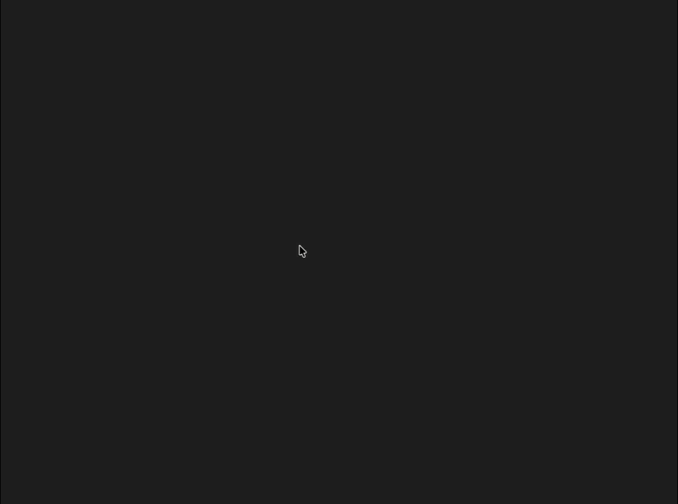

# OpieMenu

[English](README.md) | **简体中文**

用 Swift 和 AppKit 实现的 macOS 鼠标位置径向菜单，提供可复用的 Swift Package 和菜单栏示例应用 OpieNative。视觉和交互参考 [Opie 官网](https://opies.io/)；这是独立实现的非官方项目，与 Opie 无关联。

## 效果预览



## 接入你的应用

在 Xcode 中选择 **File → Add Package Dependencies…**，填入 `https://github.com/mylxsw/opie-menu-macos.git`，并把 `OpieMenu` 产品添加到应用 target。Swift Package 也可以这样声明：

```swift
dependencies: [.package(url: "https://github.com/mylxsw/opie-menu-macos.git", branch: "main")],
targets: [
    .executableTarget(
        name: "YourApp",
        dependencies: [.product(name: "OpieMenu", package: "opie-menu-macos")]
    )
]
```

如果需要直接复制源码，整个 `Packages/OpieMenu` 文件夹也是独立的本地 Package。创建菜单、在鼠标位置显示、绑定快捷键及处理按钮的例子见 [组件文档](Packages/OpieMenu/README.zh-CN.md)。

## 运行

```sh
./build-app.sh
open build/OpieNative.app
```

启动后是菜单栏应用。按 **Control + Option + Space** 在鼠标位置打开，重复按键或按 Escape 关闭。按住快捷键移动鼠标，松开时执行指针所在扇区；轻按快捷键只会打开菜单。也可以按下鼠标、拖到目标扇区后松开执行，或直接点击。方向键选择、回车执行，数字 1–7 可直接执行对应扇区。

点击菜单栏图标，在「外观风格」中切换「经典模式」「毛玻璃效果」或「Liquid Glass」。选择会保存，下次启动仍使用该风格。

## 功能

- 三种圆环风格：经典模式为深色实体底盘；毛玻璃效果保留原有的深色模糊圆环，使用蒙版裁切 `NSGlassEffectView`（macOS 26 及以上）或 `NSVisualEffectView`（较早系统）；Liquid Glass 在 macOS 26 及以上使用 SwiftUI `glassEffect(_:in:)`，把实时变形的圆环轮廓直接交给系统玻璃材质，并随环境调整明暗。旧版保存的「Liquid Glass」偏好会自动对应到「毛玻璃效果」。
- 说明文字和多屏幕边缘避让。菜单底盘先收拢，图标和标签沿各自方向从外圈进入；选中后圆环顺时针旋转、略微扩大，中心圆盘消失，整体淡出。鼠标移向外圈时，外沿拉出瘦尖角；鼠标移出菜单窗口后仍能控制圆环。尖角收缩或释放选择时，边缘产生向两侧传播的果冻波纹。暖色高亮和紫色柔光随之过渡。
- 表情面板以缩放和淡入方式出现。
- 表情面板支持搜索、分类、点击复制并尝试粘贴到原应用。
- 深色模式、保持唤醒、静音、Mission Control、截图工具均接入 macOS；夜览会打开系统显示设置（macOS 没有公开的夜览切换接口）。
- 表情自动粘贴需要系统授予“辅助功能”权限；未授权时仍可从剪贴板手动粘贴。

项目使用 Swift Package Manager，无第三方依赖。`build-app.sh` 产出可运行的 `build/OpieNative.app`。系统动作和表情面板留在示例应用中。

## 验证

```sh
swift test
build/OpieNative.app/Contents/MacOS/OpieNative --smoke-test
```

Package 测试覆盖不同按钮数量、扇区选择、玻璃开孔和释放回弹；示例应用的检查覆盖显示、关闭、风格切换和快捷键注册。

## 许可证

代码按 [MIT License](LICENSE) 开源。macOS 系统图标由系统提供，不包含在此许可证内。
